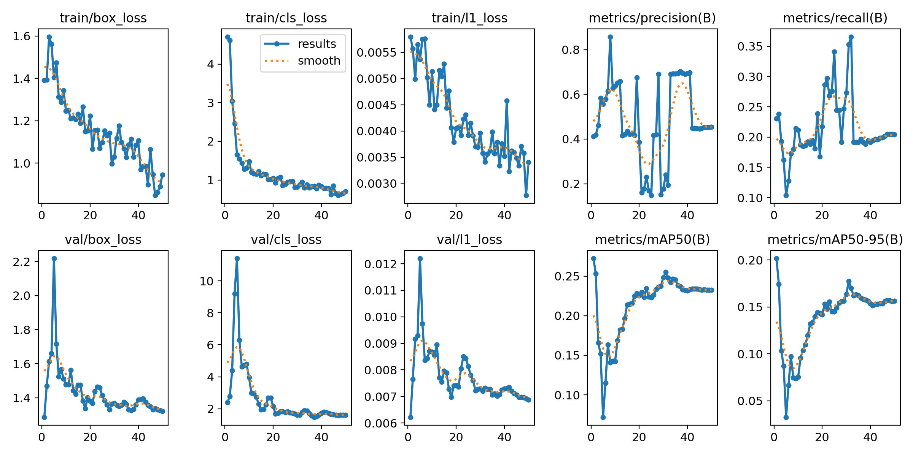
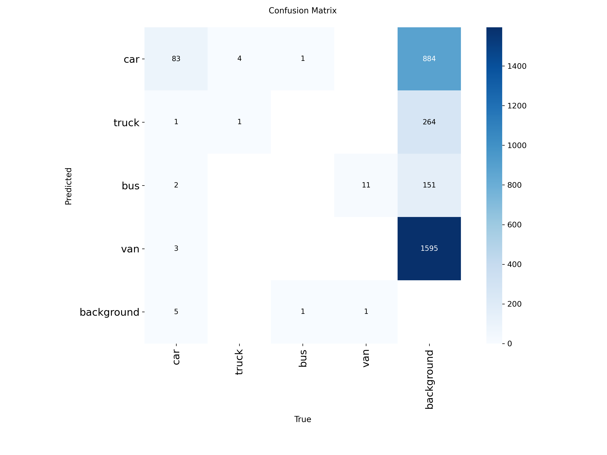
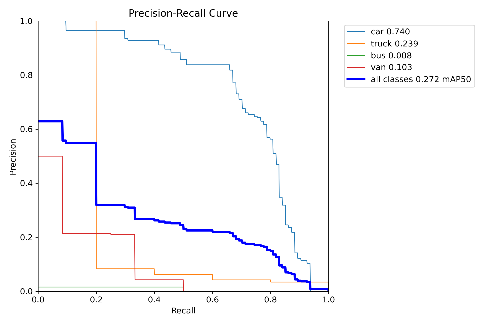
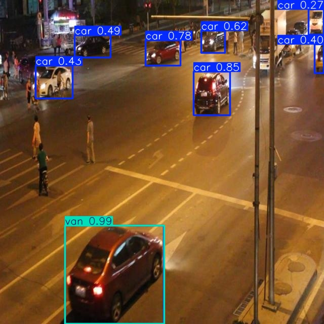
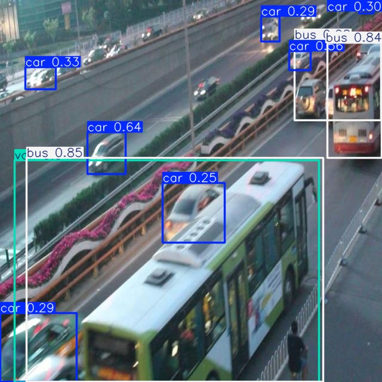
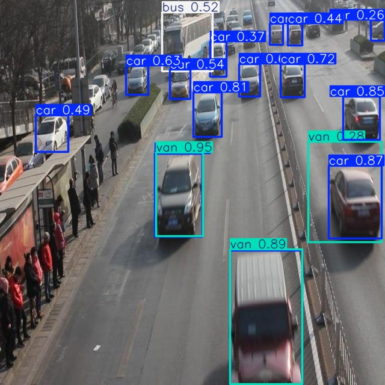

# BÁO CÁO CÁ NHÂN — NGÀY 2: OBJECT DETECTION

## 1. Thông tin học viên

- **Họ và tên:** Ngô Thị Minh Quang
- **MSSV:** 2A202603146
- **Email:** minhquang17012005@gmail.com
- **Lớp:** L2A
- **Link repository:** [K5-L2-DAY02-NgoThiMinhQuang-2A202603146-ObjectDetection](https://github.com/NgoThiMinhQuang/K5-L2-DAY02-NgoThiMinhQuang-2A202603146-ObjectDetection)
- **Link Google Colab đã chạy:** [Notebook huấn luyện YOLO26n](https://colab.research.google.com/drive/1gQec4pAkOKcSup2J4eYudVt2ceeXLETG?usp=sharing)

## 2. Schema và mini guideline

### 2.1. Schema sử dụng

Trong bài thực hành, tôi thực hiện gán nhãn phương tiện giao thông theo định dạng YOLO Detection, gồm bốn lớp đối tượng với ID cố định:

| Class ID | Tên lớp | Định nghĩa |
|---|---|---|
| 0 | `car` | Ô tô con, sedan, SUV, taxi và xe bán tải thông thường |
| 1 | `truck` | Xe tải, xe đầu kéo và các loại xe được thiết kế chuyên chở hàng hóa |
| 2 | `bus` | Xe buýt, xe khách và minibus được thiết kế chở hành khách |
| 3 | `van` | Xe van, minivan phục vụ vận chuyển hàng hóa hoặc hành khách |

Mỗi đối tượng được biểu diễn bằng một dòng nhãn YOLO:

`class_id x_center y_center width height`

Các tọa độ được chuẩn hóa trong khoảng từ 0 đến 1.

### 2.2. Nguyên tắc gán nhãn

Tôi thực hiện gán nhãn dựa trên các nguyên tắc:

- Mỗi phương tiện hợp lệ được gán một bounding box riêng.
- Bounding box cần ôm sát phần phương tiện có thể quan sát trong ảnh.
- Với phương tiện bị che khuất, chỉ gán nhãn khi phần nhìn thấy vẫn đủ để nhận diện loại xe.
- Với phương tiện bị cắt ở rìa ảnh, bounding box được giới hạn trong phạm vi ảnh.
- Không gộp nhiều phương tiện thành một bounding box.
- Không gán các đối tượng ngoài phạm vi yêu cầu như xe máy, xe đạp, người đi bộ, biển báo và đèn giao thông.
- Không tự suy đoán class đối với phương tiện quá nhỏ hoặc mờ, không đủ đặc điểm nhận diện.

Chi tiết được trình bày trong [GUIDELINE_MINI.md](../../GUIDELINE_MINI.md).

### 2.3. Ba trường hợp mơ hồ đã xử lý

| Ảnh | Tình huống | Quyết định | Lý do |
|---|---|---|---|
| `drive_002` | Một số phương tiện bị che khuất hoặc di chuyển gần nhau | Gán nhãn riêng cho phương tiện nếu phần nhìn thấy đủ để nhận diện | Xe bị che khuất vẫn cần được gán nhãn khi xác định được class |
| `drive_003` | Nhiều phương tiện xuất hiện tại giao lộ, dễ bị gộp box | Mỗi xe được vẽ một bounding box riêng | Mỗi đối tượng phải được nhận diện và phân loại độc lập |
| `drive_004` | Cảnh ban đêm, ánh sáng yếu, phương tiện nhỏ hoặc ở xa | Chỉ gán nhãn khi xác định được loại phương tiện | Tránh tạo nhãn thiếu căn cứ do hình ảnh mờ hoặc không đủ đặc điểm |

### 2.4. Các trường hợp cần làm rõ thêm

Trong quá trình thực hiện, tôi gặp khó khăn khi phân biệt một số nhóm phương tiện có hình dạng tương tự:

- `van` và `bus`, đặc biệt là minibus.
- `car` và `van`, đặc biệt đối với các dòng MPV.
- `car` và `truck` trong các trường hợp xe chở hàng nhẹ.

Theo mini guideline của bài, **xe bán tải thông thường được xếp vào lớp `car`**, không tự chuyển sang `truck`.

Đối với những phương tiện quá xa hoặc bị che khuất khiến việc phân loại không rõ ràng, tôi ưu tiên tuân thủ guideline và ghi nhận trường hợp khó thay vì tự thay đổi schema.

## 3. Annotation và self-QC

### 3.1. Số lượng dữ liệu

Bộ dữ liệu thực hành gồm 60 ảnh giao thông, được chia thành:

| Tập dữ liệu | Số lượng | Mục đích |
|---|---:|---|
| Train | 50 ảnh | Gán nhãn và huấn luyện mô hình |
| Eval | 10 ảnh | Validation và đánh giá mô hình |
| Tổng | 60 ảnh | Dữ liệu của bài thực hành |

Tôi hoàn thành **50/50 file nhãn train**, từ `drive_001.txt` đến `drive_050.txt`, được lưu tại:

`dataset/labels/train/`

Tên các file nhãn tương ứng với tên ảnh trong `dataset/images/train/`.

### 3.2. Quá trình thực hiện annotation

Tôi sử dụng CVAT để quan sát ảnh, gán nhãn và rà soát bounding box.

Trong quá trình thực hiện, tôi tập trung kiểm tra các vấn đề:

- Phương tiện chưa được gán nhãn.
- Bounding box quá rộng, lệch hoặc chưa ôm sát thân xe.
- Nhiều bounding box bị trùng trên cùng một phương tiện.
- Gán nhầm giữa các lớp `car`, `truck`, `bus` và `van`.
- Gán nhãn cho những đối tượng không thuộc bốn lớp yêu cầu.

Tôi thực hiện nhiều vòng kiểm tra và chỉnh sửa nhãn, đặc biệt đối với các ảnh có mật độ phương tiện cao, ảnh ban đêm và ảnh có nhiều phương tiện bị che khuất.

### 3.3. Kết quả kiểm tra cấu trúc

Tôi sử dụng script kiểm tra nhãn có sẵn trong repository:

```bash
python tools/check_yolo_labels.py --labels dataset/labels/train
```

Kết quả kiểm tra:

- Đầy đủ 50/50 file nhãn.
- Mỗi dòng nhãn có đúng năm trường thông tin.
- Class ID nằm trong phạm vi 0–3.
- Tọa độ bounding box được chuẩn hóa.
- Bounding box có kích thước hợp lệ.

**Kết luận:** Bộ nhãn đạt yêu cầu về cấu trúc YOLO Detection.

Tuy nhiên, kết quả này chỉ xác nhận tính hợp lệ về định dạng, không chứng minh tất cả bounding box và class đều chính xác.

### 3.4. Danh sách ảnh đã rà bằng mắt

Tôi đã rà soát ít nhất 10 ảnh:

`drive_001`, `drive_002`, `drive_003`, `drive_004`, `drive_005`, `drive_006`, `drive_007`, `drive_008`, `drive_009`, `drive_010`.

Ngoài ra, tôi tiếp tục kiểm tra các ảnh có nhiều sai lệch trong quá trình đánh giá như:

`drive_012`, `drive_024`, `drive_027`, `drive_030`, `drive_041`.

### 3.5. Các lỗi phát hiện và cách xử lý

| Lỗi phát hiện | Cách xử lý |
|---|---|
| Bounding box trùng | Xóa box bị trùng trên cùng phương tiện |
| Bounding box chưa sát | Chỉnh tọa độ để box ôm sát phần nhìn thấy |
| Gán nhầm class | Quan sát lại đặc điểm phương tiện và đối chiếu guideline |
| Bỏ sót phương tiện | Bổ sung nhãn nếu có đủ căn cứ nhận diện |
| Box hoặc class không thuộc phạm vi | Loại bỏ nhãn không hợp lệ |
| Phương tiện nhỏ hoặc mờ | Kiểm tra kỹ trước khi quyết định gán nhãn |

### 3.6. Commit khóa nhãn ban đầu

Sau khi hoàn thành bộ nhãn ban đầu, tôi lưu lại phiên bản dữ liệu trên GitHub để có thể đối chiếu với các chỉnh sửa sau này.

- **Commit khóa nhãn ban đầu:** `9c06e50482279ec5b02368dbed98e1e7e6db131d`
- **Commit hoàn thiện sau rework:** `f2af7e30ef063a4be3f68abd07b2a80131e5d58d`

Việc giữ hai mốc commit giúp phân biệt bộ nhãn ban đầu với phiên bản đã được rà soát và đánh giá.

## 4. Gold QC và rework

### 4.1. Phương pháp đánh giá

Sau khi hoàn thành annotation và lưu commit ban đầu, tôi sử dụng công cụ `tools/evaluate_annotations.py` để đánh giá chất lượng nhãn dựa trên Gold Set được cung cấp cho bước QC.

Điều kiện matching:

- Hai bounding box phải thuộc cùng một class.
- IoU đạt ít nhất 0.50.
- Mỗi bounding box được ghép tối đa một lần theo quy tắc của evaluator.

Các chỉ số được sử dụng gồm:

- True Positive (TP).
- False Positive (FP).
- False Negative (FN).
- Precision.
- Recall.
- F1-score.
- Mean IoU of matches.

### 4.2. Kết quả đánh giá trước và sau rework

| Chỉ số | Trước sửa | Sau sửa |
|---|---:|---:|
| TP | — | 472 |
| FP | — | 645 |
| FN | — | 181 |
| Precision | — | 0.4226 |
| Recall | — | 0.7228 |
| **F1-score** | — | **0.5333** |
| **mean_iou_of_matches** | — | **0.8446** |
| `passed` | — | `false` |

**Giải thích dữ liệu trước rework:**

Commit khóa nhãn ban đầu là `9c06e50`. Tuy nhiên, không có file hoặc log đánh giá trước rework được xác minh trong lịch sử Git hiện có. Vì vậy, tôi để trống các chỉ số trước sửa thay vì tự điền số liệu không có căn cứ.

Kết quả sau sửa được lưu trong:

[outputs/annotation_evaluation.json](../../outputs/annotation_evaluation.json)

### 4.3. Phân tích kết quả

Theo evaluator gốc, yêu cầu chất lượng annotation là:

- F1-score ≥ 0.80.
- Mean IoU ≥ 0.70.

Kết quả của tôi:

- F1-score = 0.5333, chưa đạt ngưỡng 0.80.
- Mean IoU = 0.8446, vượt ngưỡng 0.70.

Mean IoU tương đối cao cho thấy các bounding box được ghép đúng thường có mức độ trùng khớp hình học tốt.

Tuy nhiên, số lượng False Positive còn lớn (645), khiến Precision và F1-score thấp.

Từ việc kiểm tra ảnh, tôi nhận thấy các trường hợp có khả năng ảnh hưởng đến kết quả gồm phương tiện nhỏ, đối tượng bị che khuất, bounding box thừa và sự nhầm lẫn giữa những lớp phương tiện có hình dạng tương tự.

Không thể kết luận chính xác nguyên nhân chỉ dựa trên các giá trị TP, FP và FN. Vì vậy, tôi kết hợp việc xem ảnh gốc và kiểm tra nhãn để phân tích sai lệch.

### 4.4. Quá trình rework

Tôi thực hiện rà soát và chỉnh sửa annotation qua nhiều vòng, tập trung vào các trường hợp:

- Box bị trùng hoặc quá rộng.
- Nhãn phương tiện chưa nhất quán.
- Xe nhỏ hoặc bị che khuất.
- Các ảnh có mật độ phương tiện cao.

Các ảnh được ưu tiên rà soát thêm gồm `drive_012`, `drive_024`, `drive_027`, `drive_030` và `drive_041`.

Tùy từng trường hợp, tôi quyết định:

- Giữ nguyên nhãn khi class và bounding box có đủ căn cứ.
- Điều chỉnh bounding box khi tọa độ chưa phù hợp.
- Thay đổi class khi đặc điểm xe cho thấy nhãn cũ không đúng guideline.
- Xóa box bị trùng hoặc không thuộc phạm vi bài toán.
- Bổ sung box nếu phát hiện phương tiện hợp lệ bị bỏ sót.

Việc chỉnh sửa được thực hiện dựa trên ảnh gốc và guideline. Gold Set chỉ phục vụ đánh giá, không được sao chép để thay thế bộ nhãn của tôi.

Theo thông báo của giảng viên trong quá trình thực hành, học viên được phép tiếp tục bước huấn luyện khi F1 trên 0.50. Tôi giữ nguyên kết quả evaluator là `passed=false`, không chỉnh sửa ngưỡng hoặc số liệu để tạo kết quả đạt giả.

## 5. Kết quả YOLO

### 5.1. Môi trường huấn luyện

Tôi sử dụng Google Colab để huấn luyện mô hình YOLO26n trên bộ nhãn đã hoàn thành.

| Thành phần | Thông tin |
|---|---|
| Mô hình | YOLO26n |
| Checkpoint khởi tạo | `yolo26n.pt` |
| Môi trường | Google Colab |
| GPU | NVIDIA Tesla T4 |
| Số epochs | 50 |
| Kích thước ảnh | 640 × 640 |
| Số ảnh train | 50 |
| Số ảnh eval | 10 |
| Số class | 4 |
| Batch size | Tự động theo cấu hình notebook (`batch=-1`) |
| Seed | 20260909 |
| Phiên bản Ultralytics | Chưa ghi nhận phiên bản chính xác trong báo cáo; kiểm tra từ phiên Colab |
| Phiên bản PyTorch | Chưa ghi nhận phiên bản chính xác trong báo cáo; kiểm tra từ phiên Colab |

Tôi sử dụng cấu hình huấn luyện trong notebook của bài, không đưa ảnh eval vào tập train.

Các tham số chính được thiết lập theo quá trình chạy thực nghiệm gồm 50 epochs và kích thước ảnh 640 × 640. Tôi không thực hiện thêm một thí nghiệm điều chỉnh siêu tham số độc lập để so sánh.

### 5.2. Đường dẫn best checkpoint

Quá trình huấn luyện hoàn thành 50/50 epochs.

Checkpoint tốt nhất được lưu trong phiên Colab tại:

```text
/content/Day2-Lab/outputs/yolo26_runs/vehicle_annotation/weights/best.pt
```

Checkpoint này được dùng để đánh giá và dự đoán trên tập eval.

Tôi không đưa checkpoint `.pt` lên GitHub vì quy định bài nộp không cho phép commit model weights.

### 5.3. Kết quả đánh giá trên 10 ảnh eval

Tôi sử dụng 10 ảnh `drive_051.jpg` đến `drive_060.jpg` để validation và đánh giá kết quả mô hình.

Kết quả đọc từ `model_eval_metrics.json`:

| Chỉ số trên 10 ảnh eval | Giá trị |
|---|---:|
| **Precision** | **0.4105** |
| **Recall** | **0.2303** |
| **mAP50** | **0.2723** |
| **mAP50–95** | **0.2017** |

File kết quả:

[model_eval_metrics.json](assets/model_eval_metrics.json)

Các chỉ số trên là kết quả đánh giá mô hình YOLO26n sau huấn luyện, không phải các chỉ số F1 và Mean IoU của bước Gold QC.

### 5.4. Kết quả theo từng lớp

Theo log validation của mô hình:

| Class | Số đối tượng eval | Precision | Recall | mAP50 |
|---|---:|---:|---:|---:|
| car | 94 | 0.833 | 0.637 | 0.740 |
| truck | 5 | 0.677 | 0.200 | 0.239 |
| bus | 2 | 0.000 | 0.000 | 0.0079 |
| van | 12 | 0.135 | 0.083 | 0.103 |

Tôi nhận thấy:

- Lớp `car` có kết quả tốt nhất, với mAP50 khoảng 0.740.
- Lớp `truck` có Recall thấp, cho thấy mô hình vẫn bỏ sót nhiều trường hợp.
- Lớp `bus` có Recall bằng 0.000 trong log validation, thấp nhất trong bốn lớp.
- Lớp `van` có Recall khoảng 0.083, thể hiện khó khăn trong nhận diện các phương tiện có hình dạng tương tự car hoặc bus.

Tập eval chỉ gồm 10 ảnh, trong đó một số lớp có rất ít đối tượng. Vì vậy, kết quả từng lớp còn chịu ảnh hưởng lớn của kích thước tập dữ liệu và không nên dùng để kết luận hiệu năng tổng quát của mô hình trên mọi điều kiện giao thông.

### 5.5. Minh chứng huấn luyện

**Biểu đồ huấn luyện 50 epochs**



**Confusion matrix**



**Precision–Recall Curve**



**Ảnh dự đoán trên tập eval**







Các minh chứng bổ sung:

- [Log huấn luyện results.csv](assets/yolo26_runs/vehicle_annotation/results.csv)
- [Confusion matrix chuẩn hóa](assets/yolo26_runs/vehicle_annotation/confusion_matrix_normalized.png)
- [Precision Curve](assets/yolo26_runs/vehicle_annotation/BoxP_curve.png)
- [Recall Curve](assets/yolo26_runs/vehicle_annotation/BoxR_curve.png)
- [F1 Curve](assets/yolo26_runs/vehicle_annotation/BoxF1_curve.png)
- [Validation Labels](assets/yolo26_runs/vehicle_eval/val_batch0_labels.jpg)
- [Validation Predictions](assets/yolo26_runs/vehicle_eval/val_batch0_pred.jpg)

### 5.6. Nhận xét một ảnh dự đoán cụ thể

Tôi chọn ảnh `drive_051.jpg` để quan sát kết quả dự đoán.

Trong ảnh giao thông ban đêm này, mô hình tạo bounding box cho một số ô tô đang di chuyển trên đường. Một phương tiện màu đỏ ở khu vực phía dưới ảnh được dự đoán là `van` với độ tin cậy cao, trong khi các phương tiện khác được mô hình dự đoán chủ yếu là `car`.

Ví dụ này cho thấy mô hình đã học được đặc điểm nhận diện phương tiện và có khả năng tạo bounding box trên ảnh chưa được dùng để cập nhật trọng số huấn luyện.

Tuy nhiên, nhãn dự đoán có độ tin cậy cao không đồng nghĩa chắc chắn đúng ground truth. Cần đối chiếu ảnh và nhãn eval để xác định chính xác các trường hợp True Positive, False Positive hoặc nhầm class.

Ở những ảnh có nhiều phương tiện nhỏ hoặc bị che khuất, mô hình vẫn có thể bỏ sót hoặc nhận diện nhầm đối tượng.

### 5.7. Trả lời bốn câu hỏi phân tích

**Câu 1. Lớp nào có Recall thấp nhất? Ảnh nào minh họa?**

Theo log validation, lớp `bus` có Recall thấp nhất, bằng 0.000.

Tập eval có hai đối tượng bus. Kết quả cho thấy mô hình chưa ghi nhận True Positive cho lớp này theo điều kiện đánh giá tương ứng.

Tôi sử dụng ảnh `drive_053.jpg` và các ảnh validation labels/predictions để đối chiếu trường hợp phương tiện bus trong tập eval.

Để xác định một dự đoán bus có đúng hay không, cần kiểm tra cả class và độ trùng khớp IoU với nhãn ground truth. Một box được hiển thị với tên `bus` không tự động được tính là True Positive.

**Câu 2. Nếu mAP50 cao nhưng mAP50–95 thấp, cần kiểm tra điều gì trên bounding box?**

mAP50 sử dụng ngưỡng IoU 0.50, còn mAP50–95 là giá trị trung bình qua nhiều ngưỡng IoU từ 0.50 đến 0.95.

Khi mAP50 cao hơn mAP50–95, cần xem xét độ chính xác hình học của bounding box:

- Box có bị lệch so với đối tượng hay không.
- Box có quá rộng hoặc quá hẹp hay không.
- Box có ôm sát phần phương tiện cần nhận diện hay không.
- Có trường hợp box chồng lấn nhiều phương tiện hay không.

Kết quả của tôi có mAP50 = 0.2723 và mAP50–95 = 0.2017. Sự chênh lệch cho thấy hiệu quả giảm khi áp dụng các ngưỡng IoU khắt khe hơn, nhưng chưa đủ để quy toàn bộ nguyên nhân cho sai số tọa độ box.

**Câu 3. Lỗi class nào có thể liên quan đến guideline? Dữ kiện nào hỗ trợ nhận xét?**

Những nhóm dễ gây nhầm lẫn trong bài toán gồm:

- `van` và `bus`: đặc biệt ở minibus hoặc phương tiện chở khách nhỏ.
- `van` và `car`: do hình dáng một số xe MPV/SUV tương tự van.
- `car` và `truck`: cần phân biệt theo guideline; xe bán tải thông thường thuộc `car`, không phải `truck`.

Dữ kiện hỗ trợ nhận xét là kết quả Recall theo từng lớp, confusion matrix và các ảnh dự đoán trên tập eval.

Cụ thể, lớp `car` có Recall 0.637, trong khi `truck` đạt 0.200, `bus` đạt 0.000 và `van` đạt 0.083. Điều này cho thấy khả năng nhận diện của mô hình không đồng đều giữa các lớp.

Tuy nhiên, chỉ số Recall thấp không tự chứng minh lỗi xuất phát từ guideline. Muốn xác định nguyên nhân cần đối chiếu các trường hợp cụ thể với ground truth và ảnh gốc.

**Câu 4. Vì sao không dùng 10 ảnh eval để train? Vai trò validation của chúng là gì?**

Mười ảnh eval được giữ riêng với tập train nhằm đánh giá mô hình trên những ảnh không được sử dụng trực tiếp để cập nhật trọng số.

Nếu đưa các ảnh này vào train, mô hình có thể học đặc điểm của chính các ảnh dùng để đánh giá, làm cho các chỉ số trở nên lạc quan và giảm tính khách quan.

Trong notebook, tập eval còn được sử dụng để validation và lựa chọn checkpoint `best.pt`.

Do đó, kết quả trên 10 ảnh eval là kết quả validation, không phải phép đánh giá trên một tập test độc lập hoàn toàn.

Tôi giữ nguyên cách chia 50 ảnh train và 10 ảnh eval theo yêu cầu bài thực hành.

## 6. Khó khăn và cách xử lý

| Bước/thời điểm | Lỗi quan sát | Cách đã thử | Kết quả/còn thiếu |
|---|---|---|---|
| Gán nhãn trên CVAT | Một số xe nhỏ, bị che khuất hoặc nằm gần nhau gây khó khăn khi tạo box | Phóng to ảnh, xem ảnh gốc và rà soát từng phương tiện | Hoàn thành 50 file nhãn nhưng một số trường hợp vẫn khó phân biệt |
| Kiểm tra annotation | Box trùng, box lệch hoặc nhầm giữa các class | Rà lại ảnh trên CVAT, chỉnh box và class theo guideline | Bộ nhãn đạt yêu cầu cấu trúc YOLO |
| Gold QC | Precision và F1 còn thấp, FP cao | Chạy evaluator, phân tích ảnh sai lệch và thực hiện rework | F1 = 0.5333, Mean IoU = 0.8446; chưa đạt ngưỡng F1 gốc |
| Huấn luyện trên Colab | Cần bảo đảm dữ liệu train và eval đúng phiên bản | Sử dụng commit nhãn hoàn thiện, kiểm tra số lượng ảnh trước khi train | Train thành công 50 epochs trên GPU Tesla T4 |
| Đánh giá mô hình | Recall thấp ở các lớp ít đối tượng, đặc biệt bus và van | Xem metrics, confusion matrix, ảnh validation và prediction | Đã xác định các hạn chế; chưa thực hiện một lần huấn luyện cải thiện riêng |
| Tổng hợp bài nộp | Kết quả Colab nằm ngoài repository | Tải ZIP kết quả, giải nén và đưa minh chứng vào thư mục báo cáo | Đã đưa ảnh prediction, log train và metrics lên GitHub |

## 7. Tự đánh giá theo rubric

Tôi đối chiếu kết quả thực hiện với các nhóm tiêu chí trong `RUBRIC.md`.

| Tiêu chí | Kết quả thực hiện | Tự đánh giá |
|---|---|---|
| Định dạng nhãn YOLO | Đủ 50/50 file, đúng cấu trúc năm trường và class ID | Đạt yêu cầu cấu trúc |
| Độ đầy đủ đối tượng | Annotation Recall = 0.7228 | Vẫn còn đối tượng bị bỏ sót hoặc chưa ghép đúng |
| Độ chính xác bounding box | Mean IoU of matches = 0.8446 | Đạt ngưỡng hình học của evaluator |
| Tính nhất quán class | Còn nhầm lẫn giữa các loại xe tương tự | Cần cải thiện |
| Mini guideline | Có định nghĩa bốn lớp và ba trường hợp mơ hồ | Đã thực hiện |
| Gold QC và rework | F1 = 0.5333; Mean IoU = 0.8446 | Mean IoU đạt, F1 chưa đạt ngưỡng gốc |
| Pipeline YOLO | Train đủ 50 epochs trên Colab, có log và metrics | Đã thực hiện |
| Phân tích kết quả | Có nhận xét từng lớp và trả lời bốn câu hỏi | Đã thực hiện |
| Minh chứng bài nộp | Có notebook, ảnh prediction và biểu đồ đánh giá | Đã bổ sung trên GitHub |

### Nhận xét chung

Qua bài thực hành, tôi đã hoàn thành quy trình từ xây dựng guideline, gán nhãn và kiểm tra dữ liệu đến huấn luyện mô hình Object Detection.

**Kết quả đạt được:**

- Hoàn thành 50/50 file nhãn YOLO.
- Xây dựng mini guideline và ghi nhận ba trường hợp mơ hồ.
- Hoàn thành kiểm tra cấu trúc và Gold QC.
- Lưu lại commit nhãn ban đầu và phiên bản sau rework.
- Huấn luyện YOLO26n thành công trong 50 epochs trên GPU Tesla T4.
- Thực hiện validation và prediction trên 10 ảnh eval.
- Tổng hợp metrics, ảnh dự đoán, biểu đồ và báo cáo lên GitHub.

**Những hạn chế:**

- F1 annotation chưa đạt ngưỡng 0.80 của evaluator gốc.
- Số lượng ảnh train nhỏ và phân bố đối tượng giữa các lớp không đồng đều.
- Khả năng nhận diện bus, van và truck còn hạn chế.
- Chưa có tập test độc lập để đánh giá sâu hơn khả năng tổng quát của mô hình.
- Chưa thực hiện thí nghiệm mở rộng dữ liệu và huấn luyện lại để so sánh mức cải thiện.

Thông qua bài thực hành, tôi hiểu rõ hơn vai trò của chất lượng dữ liệu annotation, sự nhất quán class và việc kiểm tra kết quả mô hình bằng nhiều chỉ số thay vì chỉ dựa vào một metric.

## 8. Công cụ AI và tài liệu tham khảo

### 8.1. Công cụ sử dụng

Trong quá trình thực hiện, tôi sử dụng:

- **CVAT:** Gán nhãn, quan sát ảnh và chỉnh sửa bounding box.
- **Python:** Kiểm tra định dạng nhãn và đánh giá annotation.
- **Google Colab:** Thực thi notebook huấn luyện mô hình.
- **Ultralytics YOLO26n:** Huấn luyện, validation và prediction.
- **Git/GitHub:** Quản lý các phiên bản dữ liệu và lưu trữ kết quả bài thực hành.

Tôi trực tiếp kiểm tra và chỉnh sửa nhãn trên CVAT, chạy notebook trên Google Colab, xem các ảnh prediction và đối chiếu các chỉ số với file kết quả.

### 8.2. Tài liệu tham khảo

1. `GUIDE.md` — Hướng dẫn thực hành Day 2.
2. `RULES.md` — Quy định thực hiện bài.
3. `CHECKPOINTS.md` — Các checkpoint của bài thực hành.
4. `SUBMISSION.md` — Yêu cầu và quy định nộp bài.
5. `RUBRIC.md` — Tiêu chí đánh giá.
6. `GUIDELINE_MINI.md` — Quy tắc và quyết định gán nhãn.
7. [Ultralytics Documentation](https://docs.ultralytics.com/) — Tài liệu huấn luyện và đánh giá YOLO.

Tôi giữ nguyên các kết quả đánh giá thực tế, không thay đổi evaluator hoặc số liệu để tạo kết quả đạt. Gold Set, checkpoint `.pt`, mật khẩu và token không được đưa vào repository bài nộp.